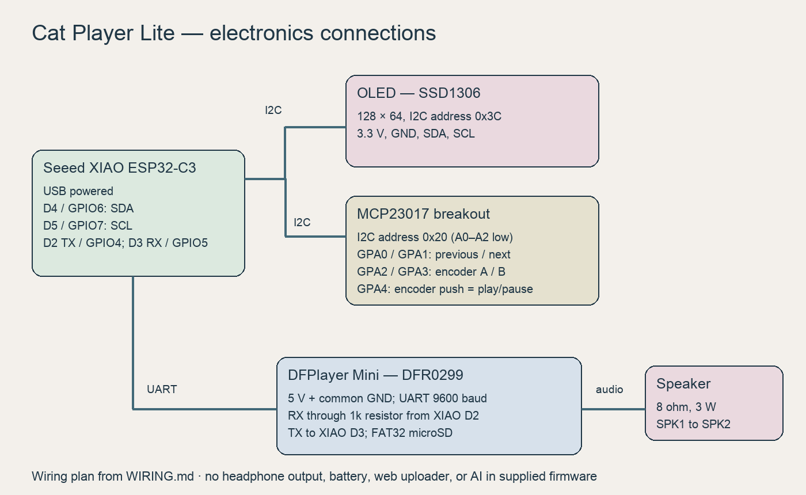
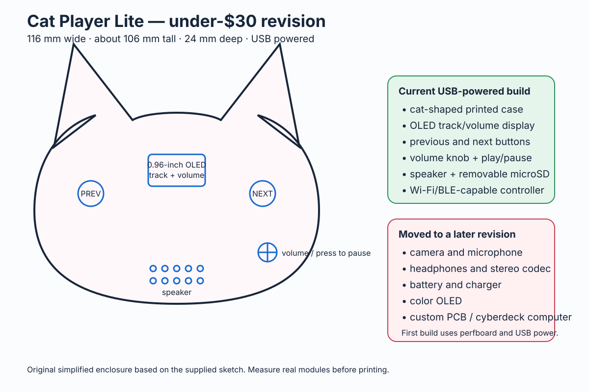
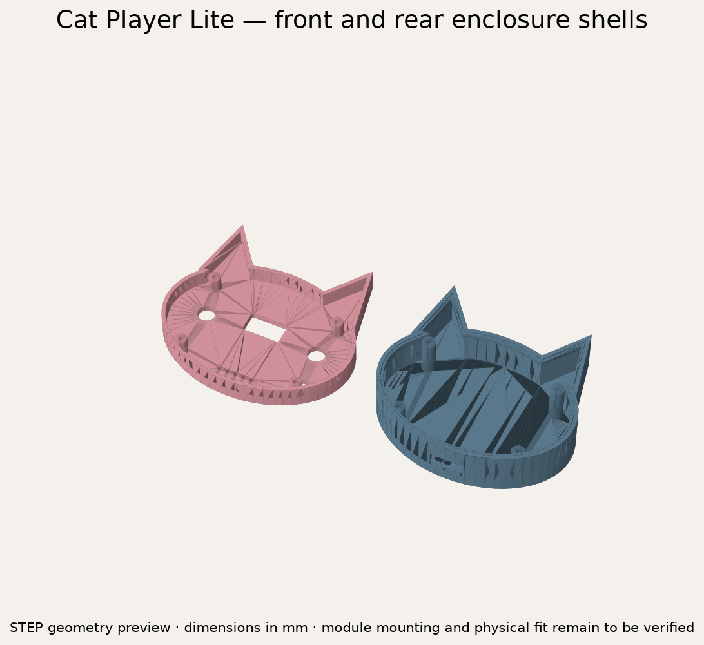

# Cat Player Lite — Music macro Pad

A cat-shaped desktop MP3 player with a screen, two track buttons, and a rotary volume knob. This is the budget revision of my Music macro Pad project: the XIAO handles controls and display, while a DFPlayer Mini reads music from microSD and drives an external prototype speaker. The target is a USB-powered perfboard build in a printed enclosure, with the replacement speaker external for initial testing.

## Features and controls

- Previous and next buttons select tracks.
- Turning the encoder changes volume from 0 to 30; pressing it toggles play/pause.
- A 128 × 64 SSD1306 OLED shows the track number, volume, playback state, and last action. It does not read song-title metadata.
- An MCP23017 provides five control inputs over I2C; the firmware enables input pull-ups.
- The DFPlayer handles MP3 decoding and speaker output. The firmware attempts to advance when a track finishes.

The supplied revision has no Bluetooth audio receiver, headphone output, microphone, website uploader, battery, or AI assistant. Those appeared in earlier ideas or prototype experiments, but are not implemented in this firmware. The October 4 journal describes a borrowed-parts Bluetooth experiment; it is not validation of this XIAO ESP32-C3 / DFPlayer configuration.

## Electronics

This is a wiring plan, not a manufactured PCB or an assembled-board photograph. Follow [WIRING.md](WIRING.md) for all connections and staged assembly. XIAO D4/GPIO6 and D5/GPIO7 carry I2C to the OLED at `0x3C` and MCP23017 at `0x20`. XIAO D2/GPIO4 sends UART commands through 1 kΩ to DFPlayer RX; D3/GPIO5 receives DFPlayer TX. DFPlayer uses USB-derived 5 V; the OLED and expander use 3.3 V. Share ground.

The speaker connects **between SPK1 and SPK2**. Neither lead goes to ground; do not attach headphones to these outputs. Start at low volume. Bench-check power rails and module pin labels before soldering.

## Enclosure and CAD

The body is 116 mm wide, with an 84 mm elliptical head and ears reaching y = 64 mm. Wall thickness is 2.2 mm; front and rear depths are 8 mm and 16 mm. Openings include the 23 × 13 mm OLED window, two 10.5 mm button apertures, a 7.4 mm encoder shaft hole, speaker grille, USB access, and microSD access. Four screw positions join the shells.

- [OpenSCAD source](enclosure/cat_player_lite_enclosure.scad) — select `front`, `back`, `fit_check`, or `assembly`.
- [Front shell STEP](enclosure/cat_player_lite_front.step)
- [Rear shell STEP](enclosure/cat_player_lite_back.step)
- [Exploded assembly STEP](enclosure/cat_player_lite_assembly.step)
- [STEP generator](enclosure/export_step.py) and [geometry validation](enclosure/step-validation.json).
- [Dimensioned SVG blueprint](enclosure/cat_player_lite_blueprint.svg).

The original Shapr3D file was lost; these files derive from the repository's existing OpenSCAD reconstruction. The STEP outline retains its 64-segment profile, with analytic round bores. A 0.5 mm shoulder now connects the rear inset ring to the wall; without it the original ring floated across a 0.35 mm gap. Both sources include that support. The assembly STEP separates the shells by 5 mm for inspection.

These are enclosure shells, not a mechanically validated assembly. Module mounts, OLED active-area fit, button actuators, screw choice, and cable clearance still need measurement. Print the fit-check coupon first; the large face apertures need suitable button caps or an actuator solution for the small tactile switches. Do not assume the current cutouts prove the purchased modules will fit.

## Firmware setup

Open [firmware/cat_player_lite.ino](firmware/cat_player_lite.ino) in Arduino IDE and select **XIAO_ESP32C3** with the ESP32 board package. Install DFRobotDFPlayerMini, Adafruit GFX, Adafruit SSD1306, and Adafruit MCP23017 Arduino Library. The detailed setup is in [firmware/README.md](firmware/README.md).

Format a microSD card FAT32 and put tracks in `/mp3/0001.mp3`, `/mp3/0002.mp3`, etc. Remove macOS `._` metadata files before ejecting. Upload the sketch and open Serial Monitor at 115200 baud; the DFPlayer UART runs at 9600 baud. Check the player, then the UART, display, controls, and finally the combined perfboard build before fitting the enclosure.

## Bill of materials

| Part | Qty | Unit USD | Total USD | Vendor / product link |
| --- | ---: | ---: | ---: | --- |
| Microcontroller — Official XIAO ESP32-C3 price checked 2026-10-01 | 1 | $4.99 | $4.99 | [Seeed Studio](https://www.seeedstudio.com/Seeed-XIAO-ESP32C3-p-5431.html) |
| MP3 module — DFPlayer Mini DFR0299 | 1 | $5.90 | $5.90 | [DFRobot](https://www.dfrobot.com/product-1121.html) |
| OLED — DFR0486 SSD1306 128x64; includes PH2.0 cable; 41.2x26.2mm PCB; verify I2C address and mounting | 1 | $14.90 | $14.90 | [DFRobot](https://www.dfrobot.com/product-1576.html) |
| I/O expander — MCP23017 I2C breakout | 1 | $5.95 | $5.95 | [Adafruit](https://www.adafruit.com/product/5346) |
| Speaker — FIT0502 passive 8-ohm 3W; 70x30x16mm; one external mono speaker for prototype; enclosure mount needs revision | 1 | $3.50 | $3.50 | [DFRobot](https://www.dfrobot.com/product-1506.html) |
| Rotary encoder — Bourns encoder with push switch | 1 | $2.89 | $2.89 | [DigiKey](https://www.digikey.com/en/products/detail/bourns-inc/PEC11R-4315K-S0012/4699233) |
| Momentary buttons — Omron B3F-1000 normally-open tactile switches | 2 | $0.35 | $0.70 | [DigiKey](https://www.digikey.com/en/products/detail/omron-electronics-inc-emc-div/B3F-1000/33150) |
| microSD card — Use an existing FAT32 card preferably 32 GB or smaller | 1 | $0.01 | $0.01 | Reuse existing card |
| Prototype materials — Use existing perfboard wire headers solder and 1k resistor | 1 | $0.01 | $0.01 | Reuse home or school stock |
| Enclosure materials — Use existing filament and four small screws | 1 | $0.01 | $0.01 | Reuse school makerspace stock |
| Parts subtotal | | | **$38.86** | |
| Delivery, tax and tariff allowance | | | **$24.00** | Estimated; final checkout pending |
| Budget total | | | **$62.86** | Tier 2: $65; $2.14 unallocated |

The live Half Life project uses **Tier 2 ($65)**, supported by the existing 13 logged design hours. Prices were checked against the selected vendor carts on October 20, 2026. The revised DFRobot cart contains DFR0299 ($5.90), DFR0486 ($14.90), and FIT0502 ($3.50): $24.30 of merchandise. Seeed's selected XIAO ESP32-C3 is $4.99; Adafruit's MCP23017 is $5.95; DigiKey's encoder and two buttons are $3.59. The remaining $0.03 consists of three platform placeholders for reused supplies, not actual one-cent offers. Reused stock must be confirmed before the build.

The $24 delivery/tax/tariff amount is a **budget allowance, not a delivered checkout quote**. DigiKey currently estimates $4.99 USPS Ground Advantage shipping plus $1.07 tariff; $17.94 remains within that allowance for the other three shipments and applicable taxes. Final destination-dependent charges must be verified before ordering. If they exceed the allowance plus the $2.14 unallocated balance, revise sourcing before purchasing. No order has been placed.

The unavailable AliExpress OLED and Adafruit #4227 speaker have been replaced with [DFRobot DFR0486](https://www.dfrobot.com/product-1576.html) and [DFRobot FIT0502](https://www.dfrobot.com/product-1506.html). The OLED is a 3.3–5V SSD1306 I2C display; use 3.3V here, wire the included cable by its VCC/GND/SCL/SDA labels, and verify its address against the firmware. Its PCB is 41.2 × 26.2 mm and active area is 21.744 × 10.864 mm. The new 70 × 30 × 16 mm speaker remains **external during prototype testing**; the current case has no verified mount for it. Connect one speaker across SPK1/SPK2; the vendor's “stereo” product name does not make the DFPlayer speaker output stereo. Module mounting and cable routing remain to be measured.

Use [BOM.csv](BOM.csv) for the current itemized budget and [BOM.md](BOM.md) for the readable copy. The historical under-$30 target has been replaced by this Tier 2 budget.

## Status and next checks

The firmware, wiring plan, OpenSCAD source, STEP shells, and blueprint are available. STEP files are checked for valid solids and reimported to compare volume with the exported shapes; this does not prove printability or physical fit. This documentation update does not claim a new firmware compile or a working final hardware build. Remaining work includes confirming supplies and checkout costs, measuring actual modules, adding their internal mounts, printing a fit coupon, assembling the intended DFPlayer circuit, and testing playback, controls, and enclosure access. Historical work and screenshots are in [JOURNAL.md](JOURNAL.md).
